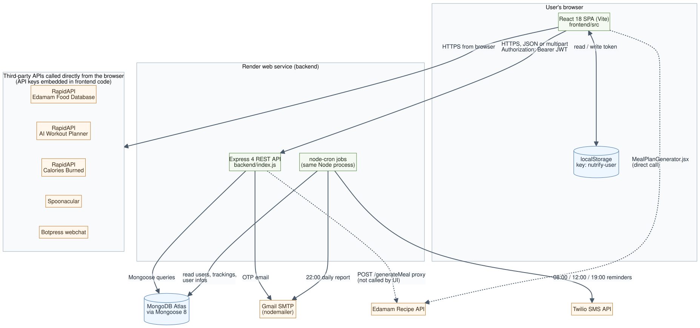

# Smart Nutrition Tracker

A full-stack web application for logging meals, tracking calories, macronutrients and water intake, calculating BMI and a daily calorie goal, and sharing posts with a small community. Users register with an email OTP, log in with a JWT, and receive a nightly nutrition summary by email and meal-time SMS reminders.

> **Project status:** working academic / portfolio project with known bugs and security gaps.
> This documentation describes the code **as it currently exists** (commit `aa8f5a8`). Features are labelled honestly as implemented, partially implemented, UI only or non-functional. See [Known limitations](docs/12-known-limitations.md) and [SECURITY.md](SECURITY.md) before deploying it anywhere public.

> **About the name:** the repository is called *Smart Nutrition Tracker*. Inside the code you will also see **NutriQuest** (frontend `package.json`, page footer) and **NutriFy** (backend `package.json` name `nutrify`, the test email text, the localStorage key `nutrify-user`). These are earlier names that were never unified. This documentation uses *Smart Nutrition Tracker* throughout.

---

## Table of contents

- [Features at a glance](#features-at-a-glance)
- [Technology stack](#technology-stack)
- [Architecture](#architecture)
- [Repository structure](#repository-structure)
- [Quick start](#quick-start)
- [Documentation](#documentation)
- [Known limitations](#known-limitations)
- [Security](#security)
- [License](#license)

---

## Features at a glance

| Feature | Status | Where |
|---|---|---|
| Email OTP registration (Gmail via nodemailer) | ✅ Implemented | `backend/routes/auth.js`, `frontend/src/Components/Register.jsx` |
| Login with bcrypt password check and JWT | ✅ Implemented (weak token settings) | `backend/index.js:209`, `backend/verifyToken.js` |
| Food search and meal logging (Edamam Food DB via RapidAPI) | ✅ Implemented | `frontend/src/Components/Track.jsx`, `POST /track` |
| Calorie and macro scaling by grams | ✅ Implemented | `Track.jsx:118-122` |
| Daily nutrition history (Diet page) | ⚠️ Partially implemented (date bug) | `Diet.jsx:27`, `index.js:352` |
| Profile dashboard: calorie progress, macro pie chart | ⚠️ Partially implemented (same date bug) | `Profile.jsx` |
| BMI and daily calorie requirement (Mifflin-St Jeor) | ✅ Implemented with known calculation bugs | `UserInfo.jsx:44-98` |
| Water intake tracking | ✅ Implemented (minor bugs) | `Profile.jsx`, `POST/GET /water_intake` |
| Community posts with images, view and delete | ⚠️ Partially implemented (feed shows 5 random posts) | `Community.jsx`, `PostCreate.jsx`, `/posts` routes |
| Profile photo upload | ✅ Implemented | `Profile.jsx`, `/upload_profile_photo` |
| Nightly email nutrition report (cron 22:00) | ✅ Implemented | `backend/Controllers/reportController.js` |
| SMS meal reminders via Twilio (cron 08:00, 12:00, 19:00) | ✅ Implemented | `backend/sendMessage.js` |
| Workout plan and nutrition advice (RapidAPI AI planner) | ✅ Implemented (third-party, called from browser) | `GenerateWorkoutPlan.jsx`, `NutritionAdvice.jsx` |
| Calories burned calculator, recipes by ingredients | ✅ Implemented (third-party, not linked in navigation) | `TrackBurnedCalories.jsx`, `Ingredients.jsx` |
| Weekly meal plan generator | ❌ Non-functional | `MealPlanGenerator.jsx` |
| Local food database page (`/food`) | ❌ Non-functional | `Food.jsx` |
| Video-call slot booking | 🎨 UI only (no backend) | `SlotBooking.jsx` |
| Chat, "My Posts", Google login | ⛔ Not implemented | see [Features](docs/02-features-and-status.md) |

Full details, evidence and reasons: [docs/02-features-and-status.md](docs/02-features-and-status.md).

## Technology stack

| Layer | Technologies (versions from `package.json` / `package-lock.json`) |
|---|---|
| Frontend | React 18.3.1, Vite 7.1.12, React Router DOM 6.26.2, Axios 1.13.1, Chart.js 4.4.4 + react-chartjs-2 5.2.0, React-Bootstrap 2.10.5, Bootstrap 5.3.3 (CDN), ESLint 9 |
| Backend | Node.js, Express ^4.21.0, Mongoose ^8.0.2, bcryptjs ^2.4.3, jsonwebtoken ^9.0.2, node-cron ^3.0.3, nodemailer ^7.0.10, twilio ^5.3.5, multer ^1.4.5-lts.1, morgan, cors, dotenv |
| Database | MongoDB (the commit history refers to MongoDB Atlas) |
| External services | Gmail SMTP, Twilio SMS, Edamam (Food DB via RapidAPI, Recipe API), RapidAPI AI Workout Planner, RapidAPI Calories Burned, Spoonacular, Botpress webchat |
| Hosting | Backend on Render (URL hardcoded in the frontend). Frontend hosting is not recorded in the repository. |

The backend has no lockfile, so its versions are the ranges declared in `backend/package.json`.

## Architecture



The React single-page app talks to one Express API over HTTPS. The API stores data in MongoDB through Mongoose, sends email through Gmail and SMS through Twilio, and runs scheduled jobs with `node-cron` inside the same Node process. Several features call third-party APIs **directly from the browser**, with their API keys embedded in frontend code.

More: [System architecture](docs/03-system-architecture.md) · [Frontend](docs/04-frontend-architecture.md) · [Backend](docs/05-backend-architecture.md) · [Database](docs/06-database-design.md) · [All diagrams](docs/diagrams/README.md)

## Repository structure

```
Smart-Nutrition-Tracker/
├── backend/                 Express API (entry point: index.js)
│   ├── Controllers/         reportController.js (daily email report)
│   ├── models/              8 Mongoose models
│   ├── routes/              auth.js (OTP registration router)
│   ├── services/            mailService.js (nodemailer)
│   ├── scripts/             dry_run_report.js, create_test_user.js (empty)
│   ├── sendMessage.js       Twilio SMS broadcast
│   └── verifyToken.js       JWT middleware
├── frontend/                React + Vite single-page app
│   └── src/
│       ├── App.jsx          route table
│       ├── contexts/        UserContext
│       └── Components/      19 page and UI components
├── docs/                    project documentation (this documentation set)
├── README.md  SECURITY.md  CHANGELOG.md
```

## Quick start

Prerequisites: Node.js (Vite 7 needs Node 20.19+ or 22.12+), npm, a MongoDB connection string, and optionally Gmail, Twilio and Edamam credentials.

```bash
# 1. Backend
cd backend
npm install
# create backend/.env (see docs/10-environment-configuration.md for every variable)
npm start            # runs "nodemon index.js", listens on PORT or 8000

# 2. Frontend (new terminal)
cd frontend
npm install
npm run dev          # Vite dev server
```

> **Important:** the frontend calls the deployed Render backend URL, which is **hardcoded** in 13 component files. There is no `VITE_` environment variable for the API URL yet, so a local frontend will talk to the deployed backend, not your local one. See [Setup and installation](docs/09-setup-and-installation.md).

These commands come from the `package.json` scripts. They were **not executed** while writing this documentation.

## Documentation

| # | Document | What it covers |
|---|---|---|
| — | [Documentation index](docs/README.md) | Reading order and summary of every document |
| 1 | [Project overview](docs/01-project-overview.md) | Purpose, users, scope, naming |
| 2 | [Features and implementation status](docs/02-features-and-status.md) | Evidence-based status of every feature |
| 3 | [System architecture](docs/03-system-architecture.md) | Components, data flow, deployment view |
| 4 | [Frontend architecture](docs/04-frontend-architecture.md) | Routes, components, state, API calls |
| 5 | [Backend architecture](docs/05-backend-architecture.md) | Middleware, routes, services, crons |
| 6 | [Database design](docs/06-database-design.md) | Collections, fields, relationships, indexes |
| 7 | [API reference](docs/07-api-reference.md) | All 26 endpoints |
| 8 | [Authentication and OTP flow](docs/08-authentication-and-otp-flow.md) | Registration, login, JWT, route guard |
| 9 | [Setup and installation](docs/09-setup-and-installation.md) | Local development |
| 10 | [Environment configuration](docs/10-environment-configuration.md) | Every environment variable |
| 11 | [Deployment guide](docs/11-deployment-guide.md) | Render backend, frontend hosting, caveats |
| 12 | [Known limitations](docs/12-known-limitations.md) | Bugs, gaps and technical debt |
| 13 | [Core CS subject mapping](docs/13-core-cs-subject-mapping.md) | OOP, DBMS, OS, CN, DSA, SE overview |
| 14 | [Interview preparation](docs/14-interview-preparation.md) | Project questions with detailed answers |
| 15 | [Testing](docs/15-testing.md) | Current test status and a test plan |
| 16 | [External integrations](docs/16-external-integrations.md) | Every third-party service |
| — | [Core subjects (deep dives)](docs/core-subjects/README.md) | One document per subject plus interview questions |

## Known limitations

The most important ones:

1. **Missing authorization:** 16 of 26 endpoints have no token check, and no endpoint checks that the `userId` in the request belongs to the logged-in user.
2. **Data exposure:** `GET /track/:userid/:date` needs no token and returns the user's password hash and OTP fields.
3. **Exposed API keys:** third-party API keys are hardcoded in frontend source.
4. **Date bug:** the Diet and Profile pages send dates as month-day-year, while the backend reads day-month-year, so history is usually empty or shows the wrong day.
5. **No tests:** there are no automated tests and no CI.

Full list: [docs/12-known-limitations.md](docs/12-known-limitations.md).

## Security

Read [SECURITY.md](SECURITY.md). It lists the existing risks, explains why each matters, and gives the recommended fixes. **None of these issues have been fixed yet.**

## License

The repository does not contain a license file, so no license has been granted. The owner needs to choose one.
