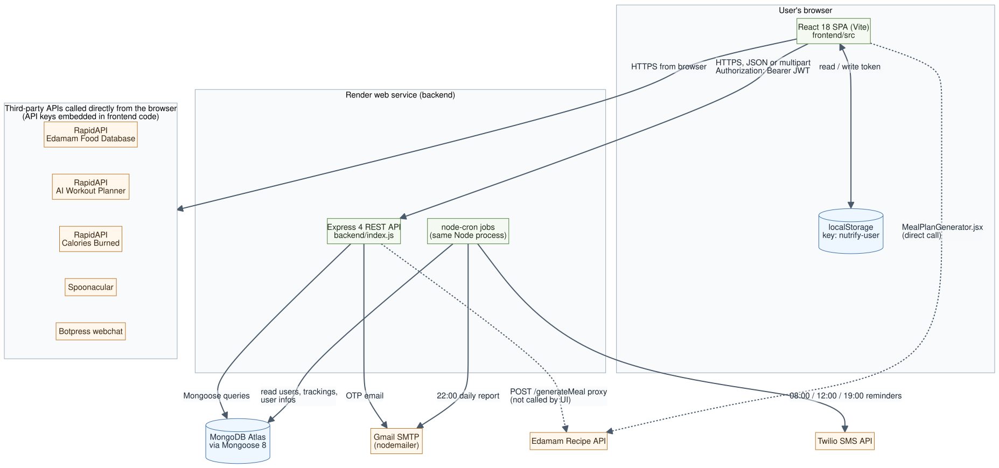

# 3. System Architecture

## 3.1 Architectural style

Smart Nutrition Tracker is a **three-tier client–server application**:

| Tier | Technology | Responsibility |
|---|---|---|
| Presentation | React 18 SPA built with Vite | Screens, form handling, client-side calculations (BMI, calories), calling APIs |
| Application | Node.js + Express 4 (one process) | REST API, authentication, business rules, email, SMS, scheduled jobs |
| Data | MongoDB via Mongoose 8 | Persistent storage of users, profiles, meals, water, posts, photos |

The backend is a **monolith**: one Express app in one file (`backend/index.js`), with a few helper modules. Scheduled jobs (`node-cron`) run inside the same process as the web server.

## 3.2 System diagram

*Source: [01-system-architecture.mmd](diagrams/mermaid/01-system-architecture.mmd) · [PNG](diagrams/png/01-system-architecture.png)*

## 3.3 Components

| Component | Location | Role |
|---|---|---|
| React SPA | `frontend/src` | UI. Stores `{ token, userid, name }` in `localStorage` under `nutrify-user` |
| Express API | `backend/index.js` | 24 routes plus the mounted auth router |
| Auth router | `backend/routes/auth.js` | OTP registration (2 routes) |
| JWT middleware | `backend/verifyToken.js` | Verifies the `Authorization: Bearer` token |
| Mail service | `backend/services/mailService.js` | nodemailer transporter for Gmail: OTP and report emails |
| SMS service | `backend/sendMessage.js` | Twilio client: broadcast to all profiles |
| Report controller | `backend/Controllers/reportController.js` | Builds and emails the daily report |
| Mongoose models | `backend/models/*.js` | Schemas for 8 collections |
| Cron jobs | `backend/index.js:38-61` | 1 report job and 3 SMS jobs |

## 3.4 Main data flows

| Flow | Path | Diagram |
|---|---|---|
| Registration | Register.jsx → `/register/generate-otp` → Gmail → `/register/verify-otp` → MongoDB | [OTP sequence](diagrams/svg/03-otp-registration-sequence.svg) |
| Login and protected calls | Login.jsx → `/login` → JWT → `localStorage` → `Authorization` header → `verifyToken` | [Login sequence](diagrams/svg/04-login-jwt-sequence.svg) |
| Meal tracking | Track.jsx → RapidAPI (browser) → `POST /track` → MongoDB; Diet.jsx → `GET /track/...` | [Tracking sequence](diagrams/svg/05-food-tracking-sequence.svg) |
| Profile and goals | UserInfo.jsx calculates BMI and calories → `POST /userinfo` | [BMI flowchart](diagrams/svg/06-bmi-calorie-flowchart.svg) |
| Daily report | cron 22:00 → reportController → MongoDB → Gmail | [Report sequence](diagrams/svg/07-daily-report-sequence.svg) |
| SMS reminders | cron 08/12/19 → sendMessage → MongoDB → Twilio | [SMS sequence](diagrams/svg/08-sms-reminder-sequence.svg) |

## 3.5 Communication

- **Browser to backend:** HTTPS with JSON bodies (`Content-Type: application/json`), or `multipart/form-data` for image uploads. Authentication uses the `Authorization: Bearer <token>` header.
- **Backend to MongoDB:** the MongoDB wire protocol through the Mongoose driver, using the connection string in `MONGO_URI`.
- **Backend to Gmail:** SMTP through nodemailer's `service: 'gmail'` preset.
- **Backend to Twilio and Edamam:** HTTPS REST calls through the Twilio SDK and Axios.
- **Browser to third-party APIs:** direct HTTPS calls with Axios. The API keys are in the JavaScript bundle (a known risk; see [SECURITY.md](../SECURITY.md)).

## 3.6 Deployment view

| Part | Where | Evidence |
|---|---|---|
| Backend | Render web service | Hardcoded base URL (`https://smart-nutrition-tracker-f9e0.onrender.com`) in 13 frontend components (26 occurrences) |
| Frontend | **Not recorded in the repository** | No hosting configuration files exist |
| Database | MongoDB, referred to as "Atlas" in commit `ba8110b` | `MONGO_URI` environment variable |

There is no `render.yaml`, Dockerfile, `vercel.json` or CI workflow. See the [Deployment guide](11-deployment-guide.md).

## 3.7 Architectural strengths and weaknesses

**Strengths**
- A simple, easy-to-follow stack with one language (JavaScript) end to end.
- Secrets for MongoDB, Gmail, Twilio and server-side Edamam come from environment variables.
- The `/generateMeal` route shows the correct proxy pattern for keeping third-party keys on the server.
- A central error handler and `asyncHandler` wrapper exist for newer routes.

**Weaknesses**
- **Monolith file:** almost all routes and business logic live in one 850-line file, with large commented-out blocks.
- **Unsafe trust boundary:** the browser holds third-party keys and sends `userId` values that the server trusts.
- **In-process cron jobs:** they stop when a free-tier instance sleeps, and they would run more than once if the app had several instances.
- **No API base URL configuration** in the frontend.
- **Images in the database:** images are stored as base64 inside MongoDB documents.

Next: [Frontend architecture](04-frontend-architecture.md)
