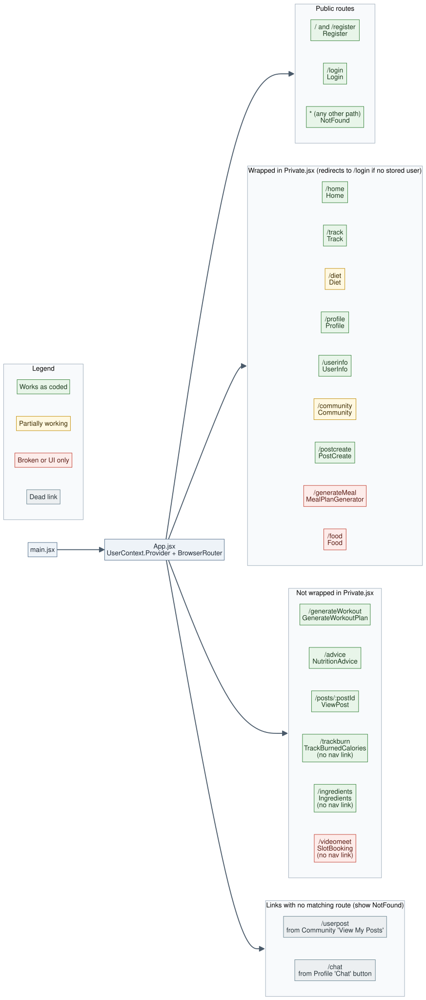

# 4. Frontend Architecture

## 4.1 Overview

| Item | Value |
|---|---|
| Framework | React 18.3.1 (function components and hooks only) |
| Build tool | Vite 7.1.12 with `@vitejs/plugin-react` 4.7.0 |
| Routing | React Router DOM 6.26.2 (`BrowserRouter`) |
| State | React Context (`UserContext`) + component `useState` + `localStorage` |
| HTTP | `fetch` and Axios 1.13.1, with full URLs written in each component |
| UI | Custom CSS, Bootstrap 5.3.3 (loaded from a CDN in `index.html`), React-Bootstrap `Carousel` |
| Charts | Chart.js 4.4.4 through react-chartjs-2 5.2.0 (`Pie` in `Profile.jsx`) |
| Linting | ESLint 9 flat config (`frontend/eslint.config.js`) |

## 4.2 Folder layout

```
frontend/
├── index.html            Bootstrap CDN, Google platform.js (unused), mounts #root
├── vite.config.js        default React plugin config
├── eslint.config.js
├── public/               placeholder.webp, vite.svg
└── src/
    ├── main.jsx          ReactDOM.createRoot(...).render(<App />)
    ├── App.jsx           UserContext provider + route table
    ├── contexts/UserContext.jsx   createContext()
    ├── App.css, index.css, styles.css, TrackBurn.css
    ├── assets/           4 images used by the UI, plus unused PDFs and an MP3
    └── Components/       19 .jsx components + 3 .css files
```

## 4.3 Routes



*Source: [09-frontend-routes.mmd](diagrams/mermaid/09-frontend-routes.mmd) · [PNG](diagrams/png/09-frontend-routes.png)*

All 19 route entries are defined in `App.jsx:20-40`:

| Path | Component | Guarded by `Private` | Reached from | Status |
|---|---|---|---|---|
| `/` | Register | No | Default page | ✅ |
| `/register` | Register | No | Login page link, NotFound | ✅ |
| `/login` | Login | No | Register link, logout, guard redirect | ✅ |
| `/home` | Home | Yes | After login, header | ✅ |
| `/track` | Track | Yes | Header, Home carousel | ✅ |
| `/diet` | Diet | Yes | Header | ⚠️ date bug |
| `/profile` | Profile | Yes | Header | ⚠️ date bug |
| `/userinfo` | UserInfo | Yes | Profile "Profile" button | ✅ (calculation bugs) |
| `/community` | Community | Yes | Header | ⚠️ 5 random posts |
| `/postcreate` | PostCreate | Yes | Community "Create Post" | ✅ |
| `/generateMeal` | MealPlanGenerator | Yes | UserInfo "Meal Plan" button | ❌ |
| `/food` | Food | Yes | Nothing links here | ❌ crashes |
| `/generateWorkout` | GenerateWorkoutPlan | No | Header "WorkOut" | ✅ |
| `/advice` | NutritionAdvice | No | Header "Nutrition" | ✅ |
| `/posts/:postId` | ViewPost | No | "View" buttons | ✅ |
| `/trackburn` | TrackBurnedCalories | No | Nothing links here | ✅ |
| `/ingredients` | Ingredients | No | Nothing links here | ✅ |
| `/videomeet` | SlotBooking | No | Nothing links here | 🎨 UI only |
| `*` | NotFound | No | Any unknown path | ✅ |

Links pointing to paths with **no route**: `/userpost` (Community and Home "View My Posts"), `/chat` (Profile "Chat").

`Login.jsx` navigates to `/Home` with a capital H. React Router v6 matches paths case-insensitively by default, so this still reaches `/home`.

## 4.4 Component responsibilities

| Component | Responsibility | Backend / external calls |
|---|---|---|
| `Register.jsx` | Two-step OTP registration form | `POST /register/generate-otp`, `POST /register/verify-otp` |
| `Login.jsx` | Login form; stores the response in context and `localStorage` | `POST /login` |
| `Private.jsx` | Route guard: renders the component or `<Navigate to="/login">` | — |
| `Header.jsx` | Navigation bar and logout | — |
| `Footer.jsx` | Static footer | — |
| `Home.jsx` | Carousel, 5 random posts, Botpress chatbot injection | `GET /posts`, Botpress CDN |
| `Track.jsx` | Food search, quantity scaling, track button | RapidAPI Edamam (auto-complete, parser), `POST /track` |
| `Diet.jsx` | Day's log and totals for a chosen date | `GET /track/:userid/:date` |
| `Profile.jsx` | Photo, calorie goal progress, pie chart, water | `GET /userinfo/:id`, `GET/POST /upload_profile_photo`, `GET /track/...`, `GET/POST /water_intake` |
| `UserInfo.jsx` | Profile form, BMI, calorie requirement | `GET /userinfo/:id`, `POST /userinfo` |
| `Community.jsx` | Post cards with title search | `GET /posts` |
| `PostCreate.jsx` | Create post form, list and delete own posts | `GET /user/:id/posts`, `POST /posts`, `DELETE /posts/:id` |
| `ViewPost.jsx` | Single post | `GET /posts/:postId` |
| `MealPlanGenerator.jsx` | Weekly meal table (non-functional) | `GET /userinfo/:id` (no token), Edamam Recipe API (direct) |
| `GenerateWorkoutPlan.jsx` | Workout plan form and result | RapidAPI AI Workout Planner |
| `NutritionAdvice.jsx` | Nutrition advice form and result | RapidAPI AI Workout Planner |
| `TrackBurnedCalories.jsx` | Activity search and calories burned | RapidAPI Calories Burned |
| `Ingredients.jsx` | Recipes from ingredients | Spoonacular |
| `SlotBooking.jsx` | Slot list (UI only) | `/api/slots` etc., which do not exist |
| `Food.jsx` | Card for a food from the local DB (crashes as a page) | `POST /track` |
| `NotFound.jsx` | 404 page | — |

## 4.5 State management

```
App.jsx
 └─ useState(loggedUser = JSON.parse(localStorage["nutrify-user"]))
     └─ <UserContext.Provider value={{ loggedUser, setLoggedUser }}>
          └─ every page reads loggedUser.token / loggedUser.userid / loggedUser.name
```

- **Login** saves `{ message, token, userid, name }` to `localStorage` and calls `setLoggedUser` (`Login.jsx:55-56`).
- **Logout** removes the key and sets the user to `null` (`Header.jsx:11-17`, also defined in `Home.jsx:26-30`).
- **No global store:** there is no Redux or other global store. All other state is local to each component (`useState`, `useEffect`).
- **No token expiry handling:** because tokens never expire, the client never needs to refresh or detect expiry.

## 4.6 Forms and validation

Validation relies on HTML attributes only: `required`, `type="email"`, `type="number"`, `min`, `maxLength`. There is no validation library and no custom error message per field.

| Form | Notable rules |
|---|---|
| Register | `required` on name, email, password; `maxLength={8}` on password (an upper limit, not a minimum); `min={12}` on age |
| Login | Email `required`; password **not** `required` |
| UserInfo | Most fields `required`; dropdowns for gender, blood group, activity, goal, diet |
| PostCreate | Title and content `required`; image optional in the UI but required by the backend |

## 4.7 API integration pattern

Every component builds its own request:

```js
fetch(`https://smart-nutrition-tracker-f9e0.onrender.com/userinfo/${loggedData.loggedUser.userid}`, {
  method: 'GET',
  headers: { "Authorization": `Bearer ${loggedData.loggedUser.token}` }
})
```

*(pattern from `Profile.jsx:47-52`)*

- **Hardcoded base URL:** the backend URL appears 26 times in 13 files. There is no shared API client and no `import.meta.env` variable.
- **Mixed libraries:** `fetch` and Axios are both used.
- **No status checks:** most calls do not check `response.ok` before reading the body.

## 4.8 Loading and error states

| Has loading and error UI | Logs errors to the console only |
|---|---|
| Home, Community, PostCreate, ViewPost, SlotBooking, TrackBurnedCalories, GenerateWorkoutPlan (loading label), NutritionAdvice (loading label), MealPlanGenerator | Track, Food, Diet, Profile, Ingredients, Register (network errors), UserInfo (shows only fetch and submit errors) |

## 4.9 Responsive design

- **Bootstrap grid:** used for post cards (`row-cols-1 row-cols-sm-2 row-cols-md-3`) and the header (`d-flex flex-wrap`).
- **Media queries:** `App.css` has 3 and `GenerateWorkoutPlan.css` has 2. The other CSS files have none.
- **Fixed width:** `Diet.jsx:81` sets `width: '800px'`, which overflows on phones.
- **Not tested:** responsiveness on real devices was not checked during this documentation.

## 4.10 Frontend issues to know about

1. The API base URL is hardcoded.
2. Third-party API keys are in components (see [SECURITY.md](../SECURITY.md)).
3. Unused dependencies: `pg`, `passport`, `passport-google-oauth20`, `google-auth-library`, `express`, `cors`, `react-tooltip`, and a self-reference `"nutriquest": "file:"`.
4. Both `package-lock.json` and `yarn.lock` are committed.
5. About 15 MB of unused files are in `src/assets` (PDFs and an MP3).
6. `index.html` still has the default title "Vite + React".
7. JSX uses `class` instead of `className` in `Header.jsx:45-46` (React warns about this in development).

Next: [Backend architecture](05-backend-architecture.md)
