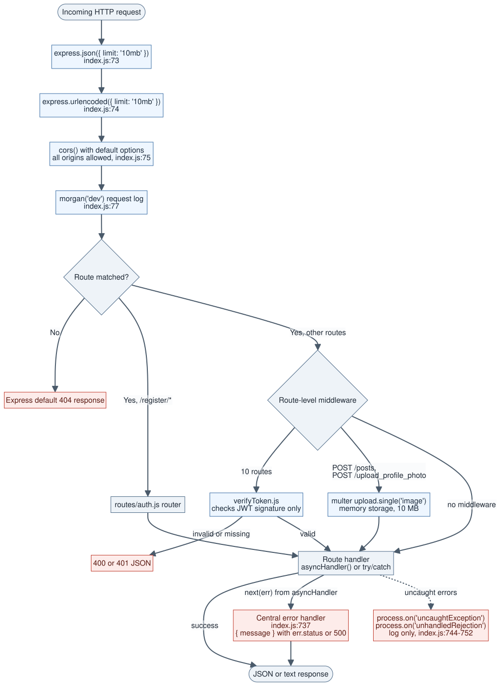

# 5. Backend Architecture

## 5.1 Overview

| Item | Value |
|---|---|
| Runtime | Node.js (no version pinned; no `engines` field) |
| Framework | Express ^4.21.0 |
| Data access | Mongoose ^8.0.2 |
| Entry point | `backend/index.js` (850 lines) |
| Start command | `npm start`, which runs `nodemon index.js` |
| Default port | `process.env.PORT` or `8000` (`index.js:722`) |
| Package name | `nutrify` |

## 5.2 Module layout

```
backend/
├── index.js                     DB connection, crons, Express app, 24 routes, error handlers
├── routes/auth.js               Express Router: POST /generate-otp, POST /verify-otp
├── verifyToken.js               JWT middleware
├── Controllers/reportController.js   generateDailyReport(), sendReportForUserId()
├── services/mailService.js      sendOtpEmail(), sendReportEmail(), verifyTransporter()
├── sendMessage.js               sendMessageToAllUsers()
├── models/                      User, foods, trackings, UserInfo, WaterIntake, Post, profilephotos, physical
└── scripts/dry_run_report.js    runs the report with email sending replaced by console output
```

This is only **partly** an MVC structure: models are separated, and there is one controller and one router, but most request handling and business logic is written inline in `index.js`.

## 5.3 Startup sequence (`index.js`)

1. **Load modules:** `require` Express, Mongoose, dotenv (`require('dotenv').config()`), bcryptjs, jsonwebtoken, twilio, axios, node-cron, morgan, cors, multer, and the local modules (lines 1-25). Loading `mailService.js` and `sendMessage.js` creates the nodemailer transporter (and calls `transporter.verify()`) and, if credentials exist, the Twilio client.
2. **Connect to MongoDB:** `mongoose.connect(process.env.MONGO_URI)`. A failure is only logged, and the process keeps running (lines 29-33).
3. **Schedule cron jobs:** the daily report (line 38) and three SMS jobs (lines 49-63), all in the `TIMEZONE` time zone (default `Asia/Kolkata`).
4. **Create the app:** the `asyncHandler` helper and multer (memory storage, 10 MB) (lines 67-69), then the Express app.
5. **Register middleware:** global middleware and routes (lines 73-720).
6. **Start listening:** `app.listen(PORT)`. `EADDRINUSE` and other server errors exit the process (lines 722-735).
7. **Error handling:** the central error handler (line 737) and process-level handlers (lines 744-752).

## 5.4 Middleware pipeline



*Source: [10-backend-middleware-pipeline.mmd](diagrams/mermaid/10-backend-middleware-pipeline.mmd) · [PNG](diagrams/png/10-backend-middleware-pipeline.png)*

| Order | Middleware | Line | Notes |
|---|---|---|---|
| 1 | `express.json({ limit: '10mb' })` | 73 | Parses JSON bodies |
| 2 | `express.urlencoded({ limit: '10mb', extended: true })` | 74 | Parses form bodies |
| 3 | `cors()` | 75 | Default options: every origin allowed |
| 4 | `morgan('dev')` | 77 | Logs each request |
| Route | `verifyToken` | per route | Used on 10 routes |
| Route | `upload.single('image')` | per route | `POST /posts`, `POST /upload_profile_photo` |
| Last | error handler `(err, req, res, next)` | 737 | Returns `{ message }` with `err.status` or 500 |

Not present: `helmet`, rate limiting, request validation (for example Joi, Zod or express-validator), compression.

### `verifyToken.js`
```js
if (req.headers.authorization !== undefined) {
  const parts = req.headers.authorization.split(" ");
  if (parts.length !== 2) return res.status(400).json({ message: 'Malformed authorization header' });
  jwt.verify(parts[1], <hardcoded secret>, (err, decoded) => {
    if (!err) { req.user = decoded; next(); }
    else res.status(401).json({ message: "Invalid Token" });
  });
} else res.status(401).json({ message: "Authorization token missing" });
```
It checks the signature only. It does not check the `Bearer` word, an expiry (none is set), or whether the user still exists.

### `asyncHandler`
```js
const asyncHandler = (fn) => (req, res, next) => Promise.resolve(fn(req, res, next)).catch(next);
```
*(`index.js:67`)* This wraps an async route so that a rejected promise goes to the central error handler. It is used by `/admin/*`, `/track`, `/water_intake` and `/generateMeal`. The older routes use their own `try/catch`.

## 5.5 Route groups

The full reference is in [07-api-reference.md](07-api-reference.md). Summary:

| Group | Routes | Auth |
|---|---|---|
| Auth | `/register/generate-otp`, `/register/verify-otp`, `/register` (legacy), `/login` | None (public by design) |
| Health | `/health` | None |
| Admin | `/admin/send-daily-report`, `/admin/test-email`, `/admin/send-daily-report/:userId` | Token |
| SMS | `/send-messages` | **None** |
| Foods (local DB) | `/foods`, `/foods/random`, `/foods/:name` | Token / none / token |
| Tracking | `POST /track`, `GET /track/:userid/:date` | Token / **none** |
| Profile | `POST /userinfo`, `GET /userinfo/:userId` | Token |
| Water | `POST /water_intake`, `GET /water_intake/:userId/:date` | Token |
| Posts | `GET /posts`, `GET /posts/:postId`, `GET /user/:userId/posts`, `POST /posts`, `DELETE /posts/:id` | **None** |
| Photos | `POST /upload_profile_photo`, `GET /upload_profile_photo/:userId` | **None** |
| Recipes | `POST /generateMeal` | **None** |

## 5.6 Business logic locations

| Logic | Location |
|---|---|
| OTP generation and verification | `routes/auth.js:9-63` |
| Password hashing and login | `index.js:181-250`, `routes/auth.js:51` |
| Date normalisation to `DD-MM-YYYY` | `index.js:309-341` (POST), `index.js:360-379` (GET); the code is duplicated |
| Profile field whitelist and upsert | `index.js:574-595` |
| Water accumulation | `index.js:614-622` |
| Random post selection | `index.js:661-669` |
| Edamam request building | `index.js:680-705` |
| Daily report totals and percentage | `reportController.js:8-37` |
| SMS phone formatting | `sendMessage.js:23-27` |

Client-side business logic (BMI, calorie requirement, nutrient scaling, water goal) is described in [Frontend architecture](04-frontend-architecture.md) and [Interview preparation](14-interview-preparation.md).

## 5.7 Scheduled jobs

| Cron expression | Time (in `TIMEZONE`) | Action | Code |
|---|---|---|---|
| `0 22 * * *` | 22:00 daily | `generateDailyReport()`: email every user yesterday's summary | `index.js:38-46` |
| `0 8 * * *` | 08:00 | SMS "Good morning! It’s time for breakfast." | `index.js:50-52` |
| `0 12 * * *` | 12:00 | SMS "It’s lunch time! Enjoy your meal." | `index.js:54-56` |
| `0 19 * * *` | 19:00 | SMS "Dinner is ready! Time to eat." | `index.js:58-60` |

The jobs run inside the web server process; see [Deployment guide](11-deployment-guide.md) for what this means on hosting platforms. Diagrams: [daily report](diagrams/svg/07-daily-report-sequence.svg), [SMS reminders](diagrams/svg/08-sms-reminder-sequence.svg).

## 5.8 Error handling

| Mechanism | Where | Behaviour |
|---|---|---|
| Per-route `try/catch` | Most older routes | Logs, then sends 500 with a message (some include the raw error) |
| `asyncHandler` + central handler | Newer routes | `{ message: err.message }` with `err.status` or 500 |
| Auth router | `routes/auth.js` | Always HTTP 200 with `{ success: false, message }` |
| Process handlers | `index.js:744-752` | Log `uncaughtException` and `unhandledRejection` and **keep running** |
| DB connection failure | `index.js:31-33` | Logged only; the server still starts |

## 5.9 Backend code-quality notes

- **Commented-out code:** about 100 lines remain (`index.js:387-404`, `517-547`, `753-850`).
- **Duplicated code:** the date normaliser is written twice.
- **Debug logging:** there are about 55 `console.log` calls across the backend and frontend, including leftover debug strings.
- **Package problems:**
  - `axios` is used but not declared in `backend/package.json`; it currently installs only because `twilio` depends on it.
  - Unused dependencies: `bcrypt`, `cron`, `mongoose-dateonly`.
  - `nodemon` is a production dependency and is used by `npm start`.
- **Config files:**
  - `backend/.gitignore` starts and ends with PowerShell command text (`@"` … `"@ | Out-File ...`), left over from how it was created. The ignore patterns in between still work.
  - `backend/.gitignore` also excludes `package-lock.json`, so installs are not reproducible.
- **Empty script:** `scripts/create_test_user.js` is an empty file.

Next: [Database design](06-database-design.md)
