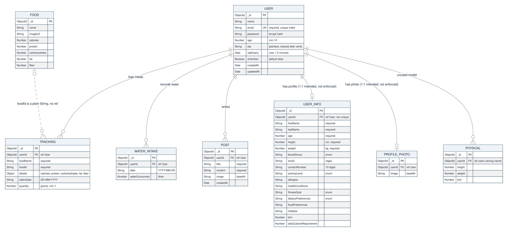

# 6. Database Design

## 6.1 Technology

- **Database:** MongoDB, a document database that stores JSON-like BSON documents in collections.
- **ODM:** Mongoose ^8.0.2, which adds schemas, type casting, validation, defaults and references on top of MongoDB.
- **Connection:** `mongoose.connect(process.env.MONGO_URI)` (`backend/index.js:29-33`). Commit `ba8110b` is titled "added mongodb atlas uri", which suggests a MongoDB Atlas cluster is used in deployment.

## 6.2 Entity–relationship diagram

*Source: [02-database-er-diagram.mmd](diagrams/mermaid/02-database-er-diagram.mmd) · [PNG](diagrams/png/02-database-er-diagram.png)*

## 6.3 Collections

Mongoose turns the model name into a lower-case plural collection name.

| Model name | File | Collection | Used? |
|---|---|---|---|
| `User` | `models/userModel.js` | `users` | Yes |
| `UserInfo` | `models/UserInfoModel.js` | `userinfos` | Yes |
| `trackings` | `models/trackingModel.js` | `trackings` | Yes |
| `WaterIntake` | `models/waterModel.js` | `waterintakes` | Yes |
| `Post` | `models/postModel.js` | `posts` | Yes |
| `profilephotos` | `models/ProfileModel.js` | `profilephotos` | Yes |
| `foods` | `models/foodModel.js` | `foods` | Backend only; no UI uses it and nothing seeds it |
| `physical` | `models/PhysicalModel.js` | `physicals` | No (routes commented out) |

### 6.3.1 `users` (`userModel.js`)
| Field | Type | Rules |
|---|---|---|
| `name` | String | — |
| `email` | String | `required`, `unique` (creates a unique index) |
| `password` | String | bcrypt hash; empty until OTP verification |
| `age` | Number | `min: 12` |
| `otp` | String | 6-digit code in plaintext; set to `null` after verification |
| `otpExpiry` | Date | now + 5 minutes |
| `isVerified` | Boolean | default `false` |
| `createdAt`, `updatedAt` | Date | `timestamps: true` |

A document is created by `generate-otp` with only `email`, OTP fields and `isVerified: false`. `verify-otp` fills in the rest.

### 6.3.2 `userinfos` (`UserInfoModel.js`)
| Field | Type | Rules in schema |
|---|---|---|
| `userId` | ObjectId → `User` | `required` (not unique) |
| `firstName`, `lastName` | String | `required` |
| `age`, `height` (cm), `weight` (kg) | Number | `required` |
| `bloodGroup` | String | `required`, enum `O+, O, A+, A, B+, B, AB+, AB` |
| `email` | String | `required`, regex `/.+\@.+\..+/` (unique commented out) |
| `contactNumber` | String | `required`, regex `/^\d{10}$/` |
| `activityLevel` | String | `required`, enum `Sedentary, Lightly Active, Moderately Active, Very Active` |
| `allergies`, `healthConditions`, `foodPreferences`, `hobbies` | String | default `''` |
| `fitnessGoal` | String | `required`, enum `Weight Loss, Muscle Gain, Maintain Current Weight` |
| `dietaryPreferences` | String | enum `Vegetarian, Vegan, Non-Vegetarian`, default `Non-Vegetarian` |
| `bmi`, `dailyCalorieRequirement` | Number | default `null` |
| `createdAt`, `updatedAt` | Date | timestamps |

> **Important:** the only write path is `findOneAndUpdate({ userId }, { $set }, { new: true, upsert: true })` (`index.js:591-595`). It runs **without** `runValidators: true`, so the `required`, `enum` and `match` rules above are **not enforced** in practice. Type casting still happens: a non-numeric `dailyCalorieRequirement` causes a CastError.

### 6.3.3 `trackings` (`trackingModel.js`)
| Field | Type | Rules |
|---|---|---|
| `userId` | ObjectId → `User` | `required` |
| `foodName` | String | `required` |
| `foodId` | String | `required`. The `ref: 'foods'` is commented out. `Track.jsx` sends a random string. |
| `details` | Embedded object | `calories`, `protein`, `carbohydrates`, `fat`, `fiber` (Numbers, already scaled to the eaten quantity) |
| `eatenDate` | String | `DD-MM-YYYY`; the default is the server's local date |
| `quantity` | Number | `required`, `min: 1` (grams) |
| timestamps | Date | — |

### 6.3.4 `waterintakes` (`waterModel.js`)
| Field | Type | Rules |
|---|---|---|
| `userId` | ObjectId → `User` | `required` |
| `date` | String | `YYYY-MM-DD`, `required` |
| `waterConsumed` | Number | litres, default 0 |

### 6.3.5 `posts` (`postModel.js`)
| Field | Type | Rules |
|---|---|---|
| `userId` | ObjectId → `User` | `required` |
| `title`, `content` | String | `required` |
| `image` | String | base64-encoded image |
| `createdAt` | Date | default `Date.now`, plus `timestamps` |

### 6.3.6 `profilephotos` (`ProfileModel.js`)
`userId` (ObjectId → `User`, `required` commented out), `image` (base64 String). No timestamps.

### 6.3.7 `foods` (`foodModel.js`)
`name`, `imageUrl`, `calories`, `protein`, `carbohydrates`, `fat`, `fiber`, all `required`, plus timestamps.

### 6.3.8 `physicals` (`PhysicalModel.js`), unused
`userId` (ref `'users'`, which does not match the model name `User`), `height`, `weight`, `bmi`.

## 6.4 Relationships

| Relationship | Type | Enforced? |
|---|---|---|
| User → UserInfo | 1 : 1 intended | No. `userId` is not unique; the upsert normally keeps one document per user |
| User → ProfilePhoto | 1 : 1 intended | No |
| User → Tracking | 1 : N | Reference only |
| User → WaterIntake | 1 : N (one per day intended) | No unique index on `{ userId, date }` |
| User → Post | 1 : N | Reference only |
| Food → Tracking | None in practice | `foodId` is a plain String |

MongoDB does not enforce foreign keys. There are no cascade deletes (and no "delete account" feature exists).

## 6.5 Indexes

| Collection | Index | Origin |
|---|---|---|
| all | `_id` (unique) | MongoDB default |
| `users` | `email` (unique) | `unique: true` in schema |

**Missing indexes** that the queries need:
- `trackings { userId: 1, eatenDate: 1 }` (used by `GET /track/...` and the daily report)
- `waterintakes { userId: 1, date: 1 }`, ideally unique
- `userinfos { userId: 1 }`, ideally unique
- `posts { userId: 1 }`
- `profilephotos { userId: 1 }`, ideally unique

Without them every such query scans the whole collection. That is fine for a small dataset but slow at scale.

## 6.6 CRUD operations by collection

| Collection | Create | Read | Update | Delete |
|---|---|---|---|---|
| users | `generate-otp` (`save`), legacy `/register` (`create`) | `/login`, `verify-otp`, report job | `verify-otp` (`save`) | — |
| userinfos | `POST /userinfo` (upsert) | `GET /userinfo/:userId`, report job, SMS job | `POST /userinfo` | — |
| trackings | `POST /track` | `GET /track/:userid/:date`, report job | — | — |
| waterintakes | `POST /water_intake` | `GET /water_intake/:userId/:date` | `POST /water_intake` (adds) | — |
| posts | `POST /posts` | `GET /posts`, `/posts/:postId`, `/user/:userId/posts` | — | `DELETE /posts/:id` |
| profilephotos | `POST /upload_profile_photo` | `GET /upload_profile_photo/:userId` | `POST /upload_profile_photo` | — |
| foods | — | `GET /foods`, `/foods/random`, `/foods/:name` | — | — |

## 6.7 Design decisions and trade-offs

| Decision | Benefit | Cost |
|---|---|---|
| Copy food name and scaled nutrients into each tracking entry (denormalisation) | The history stays correct even if the external food data changes; no join is needed | Data is duplicated |
| Dates stored as text (`DD-MM-YYYY`, `YYYY-MM-DD`) | Easy equality match for "one day" | Two different formats; text cannot be range-queried or sorted correctly; time-zone ambiguity |
| Images stored as base64 in documents | No separate file storage needed | About 33% larger; 16 MB document limit; heavy queries |
| Upsert for profile and photo | One request handles create and update | Validators skipped; no unique index to stop duplicates |
| Read-then-write for water | Simple code | Race condition; `$inc` with `upsert` would be atomic |

## 6.8 Data flow example: logging a meal

1. `Track.jsx` sends `{ userId, foodId, foodName, details: { calories: "123.45", ... }, quantity }`. The numbers arrive as text because of `toFixed(2)`.
2. `POST /track` adds `eatenDate` (today, `DD-MM-YYYY`) and calls `trackingModel.create`. Mongoose casts the text numbers to `Number`.
3. Later, `GET /track/:userid/:date` finds documents with `{ userId, eatenDate }` and populates `userId` (and tries `foodId`, which has no ref, so nothing changes).
4. At 22:00 the report job reads the same documents for "yesterday" and sums `details`.

Next: [API reference](07-api-reference.md)
