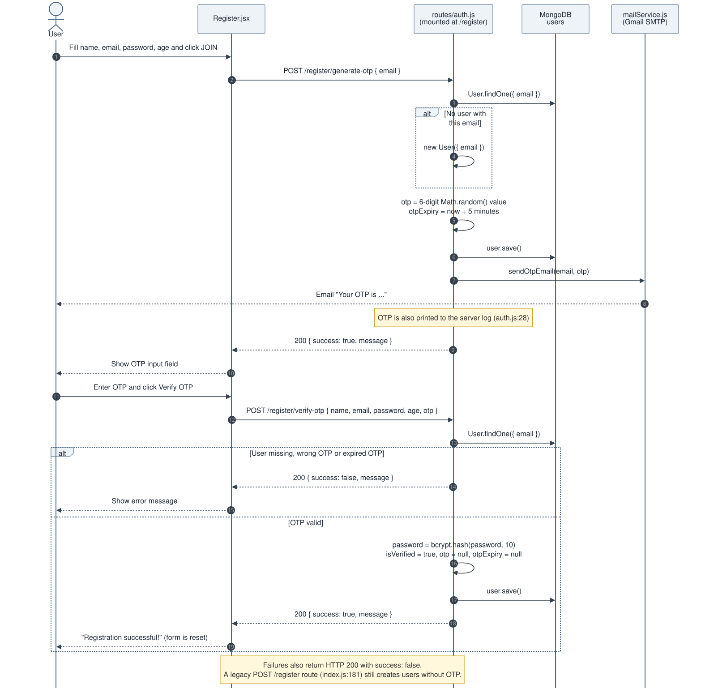
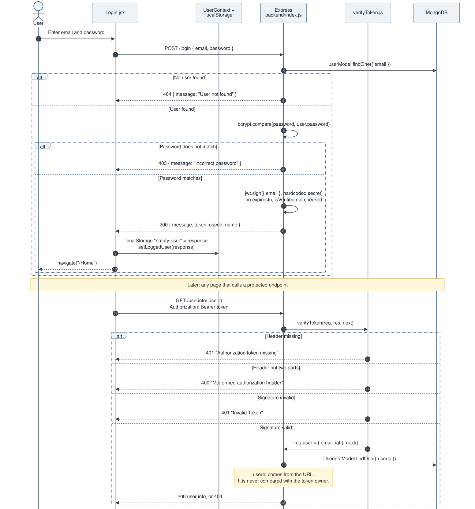

# 8. Authentication and OTP Flow

This document explains how users register, verify their email, log in, and how the frontend and backend decide who is allowed to do what. The security weaknesses are described as **existing risks**; none has been fixed.

## 8.1 Building blocks

| Piece | File | Technology |
|---|---|---|
| OTP registration router | `backend/routes/auth.js` | Express Router mounted at `/register` (`index.js:143`) |
| OTP email | `backend/services/mailService.js` | nodemailer, `service: 'gmail'`, `EMAIL_USER` / `EMAIL_PASS` |
| Password hashing | `routes/auth.js:51`, `index.js:185-188` | bcryptjs, cost factor 10 |
| Login and token issue | `backend/index.js:209-250` | jsonwebtoken `jwt.sign` |
| Token check | `backend/verifyToken.js` | jsonwebtoken `jwt.verify` |
| Client session | `Login.jsx`, `App.jsx`, `contexts/UserContext.jsx` | React Context + `localStorage["nutrify-user"]` |
| Client route guard | `frontend/src/Components/Private.jsx` | React Router `<Navigate>` |

## 8.2 Registration with email OTP



*Source: [03-otp-registration-sequence.mmd](diagrams/mermaid/03-otp-registration-sequence.mmd) · [PNG](diagrams/png/03-otp-registration-sequence.png)*

### Step 1: request an OTP
1. The user fills in name, email, password and age, then clicks **JOIN** (`Register.jsx:78`).
2. Only the email is sent: `POST /register/generate-otp { email }` (`Register.jsx:28-34`).
3. The server finds the user by email, or creates `new User({ email })` (`auth.js:19-20`).
4. It generates the OTP:
   ```js
   function generateOtp() {
       return Math.floor(100000 + Math.random() * 900000).toString();
   }
   ```
   (`auth.js:9-11`) `Math.random()` returns a number in [0, 1). Multiplying by 900000 gives [0, 900000); adding 100000 gives [100000, 1000000); `floor` makes it a whole number. The result is always 6 digits, from 100000 to 999999.
5. It sets `otpExpiry = new Date(Date.now() + 5 * 60 * 1000)`, that is 5 minutes, and saves the user (`auth.js:23-25`).
6. It emails the OTP (`mailService.sendOtpEmail`) and also prints it to the log (`auth.js:28`).
7. It responds `{ success: true }`, and the form shows the OTP field.

### Step 2: verify the OTP
1. The user types the OTP and the form sends **all** fields plus `otp` to `POST /register/verify-otp` (`Register.jsx:50-56`).
2. The server checks: `if (user.otp !== otp || user.otpExpiry < new Date())` → "Invalid or expired OTP" (`auth.js:46`).
3. On success it stores `name`, `age`, the **bcrypt hash** of the password, sets `isVerified = true`, and clears `otp` and `otpExpiry` (`auth.js:50-57`).
4. The UI shows "Registration successful!" and resets the form. It does **not** redirect to the login page.

### Behaviour worth knowing
- **Re-registration resets credentials:** calling `generate-otp` for an existing, verified email sends a new OTP, and `verify-otp` then **overwrites** the name, password and age. In effect this is an undocumented "reset password by email OTP" path. It still requires access to the mailbox.
- **No attempt limit:** there is no limit on wrong OTP attempts and no rate limiting.
- **Errors return HTTP 200** with `success: false`.

## 8.3 Login and JWT



*Source: [04-login-jwt-sequence.mmd](diagrams/mermaid/04-login-jwt-sequence.mmd) · [PNG](diagrams/png/04-login-jwt-sequence.png)*

1. `Login.jsx` sends `POST /login { email, password }`.
2. The server runs `userModel.findOne({ email })`. If there is no user, it returns 404.
3. `bcrypt.compare(password, user.password)` checks the password. If it does not match, it returns 403. bcrypt re-hashes the typed password with the salt stored inside the hash and compares the results, so the original password is never stored or decrypted.
4. On success: `jwt.sign({ email }, <hardcoded secret>)`. The response is `{ message, token, userid, name }` (`index.js:221-224`).
5. The client stores the whole response in `localStorage["nutrify-user"]`, updates the context, and navigates to `/Home`.

### What is inside the token
A JWT has three Base64URL parts: **header.payload.signature**.
- **Header:** `{ "alg": "HS256", "typ": "JWT" }` (the jsonwebtoken default).
- **Payload:** `{ "email": "...", "iat": <issued-at seconds> }`. There is no `exp` and no user ID.
- **Signature:** `HMAC-SHA256(header + "." + payload, secret)`.

The payload is **encoded, not encrypted**: anyone can read it. The signature only proves the token was created by someone who knows the secret.

## 8.4 Using the token (authorization)

Protected requests send `Authorization: Bearer <token>`. `verifyToken.js`:
1. Missing header → `401 "Authorization token missing"`.
2. Splits the header on a space; if there are not exactly 2 parts → `400 "Malformed authorization header"`.
3. `jwt.verify(token, secret)`; on failure → `401 "Invalid Token"`.
4. On success → `req.user = { email, iat }` and `next()`.

### Which routes use it
Ten routes: the 3 admin routes, `GET /foods`, `GET /foods/:name`, `POST /track`, `POST /userinfo`, `GET /userinfo/:userId`, `POST /water_intake`, `GET /water_intake/:userId/:date`. The full table is in [API reference](07-api-reference.md#71-endpoint-index).

### Authentication vs authorization
- **Authentication** ("who are you?") is done by the token check.
- **Authorization** ("are you allowed to touch *this* record?") is **missing**. Every route takes the `userId` from the request body or URL and never compares it with the token. Because the token only contains `email`, the server could not easily make that comparison anyway. This is an Insecure Direct Object Reference (IDOR) risk; see [SECURITY.md](../SECURITY.md#s-04-no-object-level-authorization-idor).

## 8.5 Frontend session and route guard

```jsx
// Private.jsx
return loggedData.loggedUser != null ? <props.Component /> : <Navigate to="/login" />;
```

- **Only a UX convenience:** the guard prevents logged-out users from *seeing* certain pages. It is not security, because the browser can be modified and the real protection must be on the server.
- **No token check:** it does not check whether the token is valid. Since tokens never expire, a stored token works until the user logs out.
- **Unguarded routes:** six routes are not wrapped (see [Frontend architecture](04-frontend-architecture.md#43-routes)).
- **Logout** deletes `localStorage["nutrify-user"]` and clears the context. The token itself stays valid because there is no server-side revocation.

## 8.6 Known authentication risks (unfixed)

| Risk | Details |
|---|---|
| Hardcoded JWT secret | The same literal string in `index.js:221` and `verifyToken.js:12` |
| No token expiry | No `expiresIn` option |
| Unverified users can log in | `/login` does not check `isVerified` |
| OTP bypass | The legacy `POST /register` creates users without OTP |
| Weak OTP generation | `Math.random()` is not cryptographically secure; use `crypto.randomInt(100000, 1000000)` |
| OTP in plaintext and logs | Stored as plain text; printed with `console.log` |
| No rate limit | OTP and password brute force are possible |
| Token in `localStorage` | Readable by any script on the page (XSS) |
| Password length capped at 8 | `maxLength={8}` on the register form |

## 8.7 Recommended target design (not implemented)

1. Read `JWT_SECRET` from the environment, sign `{ sub: user._id, email }` with `expiresIn: '1h'`, and consider a refresh token in an `httpOnly` cookie.
2. Derive the user ID from `req.user.sub` on the server instead of trusting client-sent `userId` values.
3. Generate OTPs with `crypto.randomInt`, store a **hash** of the OTP, allow at most 5 attempts, and stop logging it.
4. Remove the legacy `/register` route and require `isVerified` at login.
5. Add `express-rate-limit` to `/login` and `/register/*`.
6. Enforce a minimum password length (at least 8) on both client and server, and remove the maximum.

Next: [Setup and installation](09-setup-and-installation.md)
