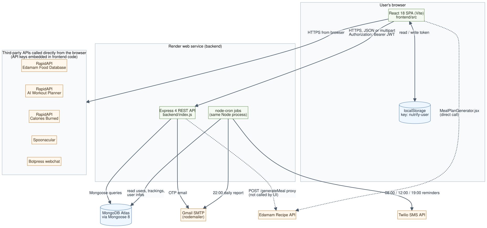

# 11. Deployment Guide

## 11.1 What is known about the current deployment

| Part | Known facts | Unknown |
|---|---|---|
| Backend | Deployed on **Render**. The frontend calls `https://smart-nutrition-tracker-f9e0.onrender.com` (commit `33886ea`). | Service plan, region, build and start commands, Node version, whether it is still running |
| Frontend | — | Hosting provider and URL are **not recorded** in the repository |
| Database | MongoDB, described as "Atlas" in commit `ba8110b` | Cluster tier and region |
| Email / SMS | Gmail SMTP and Twilio, configured by environment variables | Whether production credentials are set; whether Twilio is a trial account |

The repository contains **no** deployment configuration files: no `render.yaml`, Dockerfile, `Procfile`, `vercel.json`, `netlify.toml` or CI workflow. The steps below are a recommended procedure based on the code. They are not a record of how the project was actually deployed.

## 11.2 Deploying the backend to Render (recommended steps)

1. Create a **Web Service** from the GitHub repository.
2. **Root directory:** `backend`.
3. **Build command:** `npm install`.
4. **Start command:** `node index.js`. The repository's `npm start` uses `nodemon`, a development tool that watches files; it works, but it is not intended for production.
5. **Environment variables:** add every variable from [Environment configuration](10-environment-configuration.md). Render provides `PORT` automatically.
6. **Health check path:** `/health`.
7. **MongoDB Atlas:** allow Render's outbound IP addresses in Atlas *Network Access* (or allow all addresses, which is less secure).

## 11.3 Deploying the frontend (recommended steps)

The frontend is a static Vite build and can be hosted on any static host (Render Static Site, Netlify, Vercel, GitHub Pages and so on).

1. **Root directory:** `frontend`.
2. **Build command:** `npm install && npm run build`.
3. **Publish directory:** `dist`.
4. **SPA fallback:** configure every path to serve `index.html` (a "rewrite" rule). Without it, refreshing a page such as `/profile` returns a 404 from the host, because `BrowserRouter` relies on client-side routing.
5. **API URL:** the API base URL is hardcoded, so the frontend always calls the Render URL above. To deploy against a different backend you must change the source (see [Setup](09-setup-and-installation.md#95-connecting-the-frontend-to-your-local-backend)).

The production build was **not run** during this documentation work, so whether it builds without errors is unverified.

## 11.4 Deployment limitations

| Limitation | Why it matters |
|---|---|
| **Cron jobs run inside the web process** | On a hosting tier that sleeps idle services, scheduled emails and SMS will not fire while the service is asleep. With more than one instance, every instance would send duplicates. |
| **Server time zone** | Cron times use `TIMEZONE`, but the default `eatenDate` (`trackingModel.js:30-36`) and the report's "yesterday" (`reportController.js:42-47`) use the **server's local clock**. Cloud servers usually run in UTC, so Indian users who log food between 00:00 and 05:30 IST would get the previous day's date. |
| **Cold starts** | Free-tier services that sleep take time to wake; the first request after idle is slow. |
| **CORS allows every origin** | Works with any frontend host, but is insecure (see [SECURITY.md](../SECURITY.md)). |
| **Large request bodies** | 10 MB JSON and upload limits, with base64 images stored in MongoDB documents. |
| **No lockfile for the backend** | `package-lock.json` is git-ignored in `backend/`, so each deploy may install different minor versions. |
| **Undeclared `axios`** | Works only because `twilio` depends on it. |
| **No CI/CD or tests** | Nothing checks a commit before it is deployed. |
| **Hardcoded third-party keys** | If revoked, the related frontend features stop working in production. |

## 11.5 Post-deployment checks

1. `GET /health` returns 200.
2. Registration sends an OTP email.
3. Login returns a token, and a protected call (for example `GET /userinfo/:id` with the token) returns 200 or 404, not 401.
4. Check the logs for "Database connection successful" and "Mailer is configured and ready".
5. To check email delivery without waiting for 22:00, call `POST /admin/test-email` with a valid token.

## 11.6 Recommended improvements (not implemented)

- Add `render.yaml` (or an equivalent) so the deployment is reproducible.
- Move scheduled jobs to a separate worker or a platform cron job, and protect manual triggers with real admin checks.
- Add `VITE_API_URL` and a shared API client.
- Commit a backend lockfile and add an `engines` field.
- Use `node index.js` as the production start command.

Next: [Known limitations](12-known-limitations.md)
