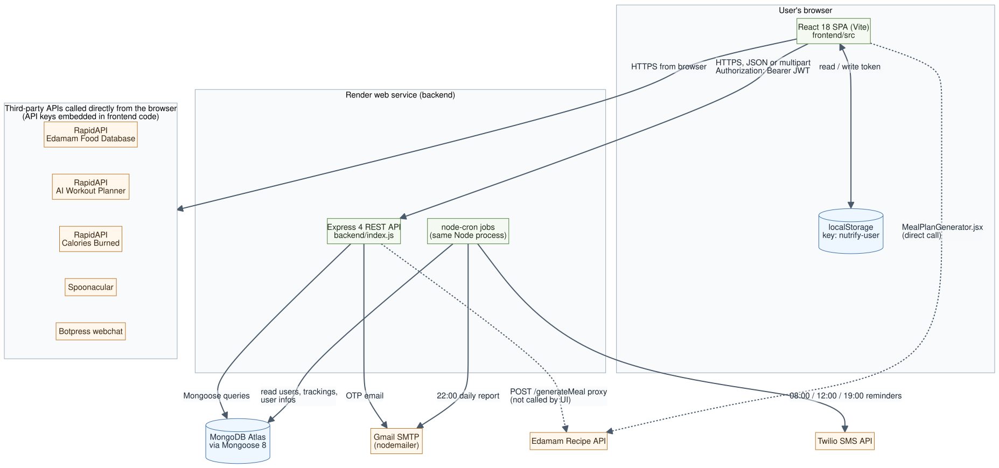
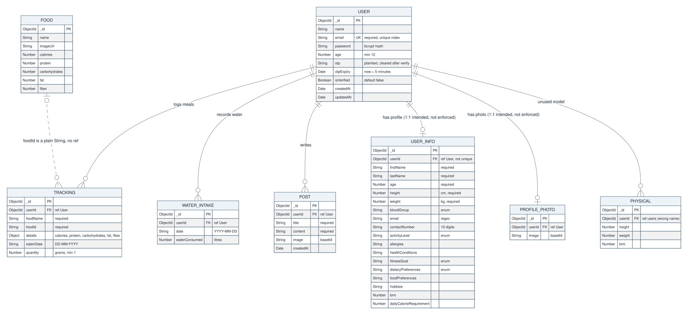
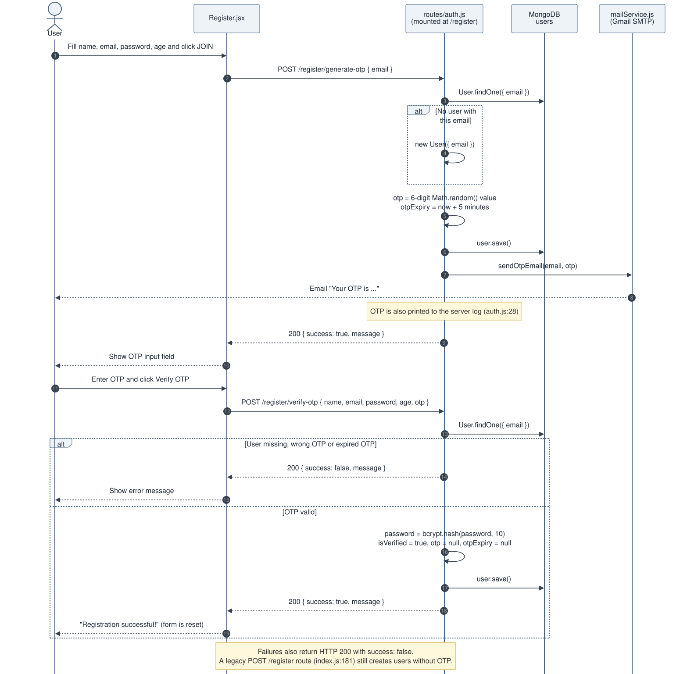
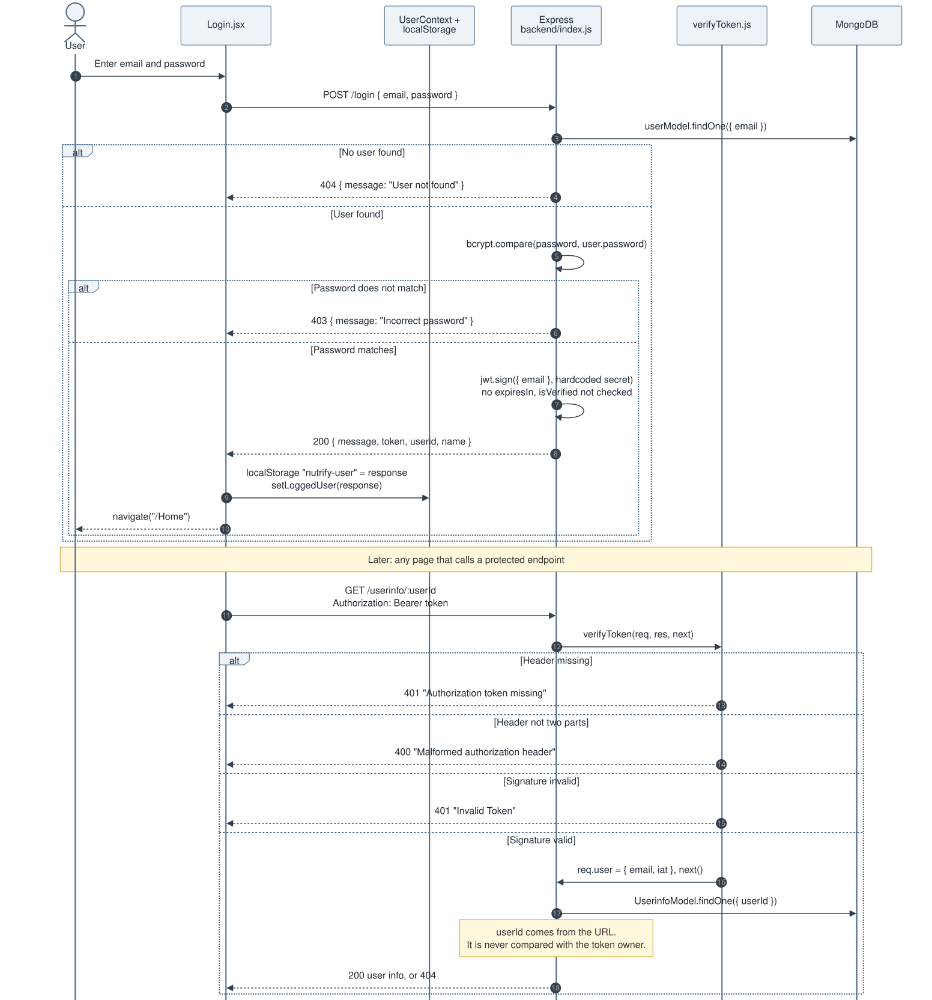
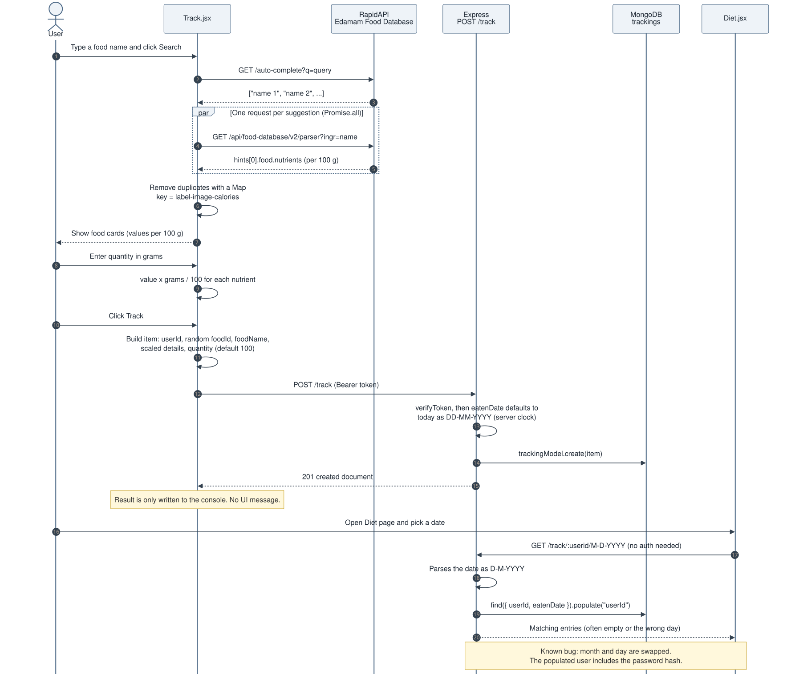
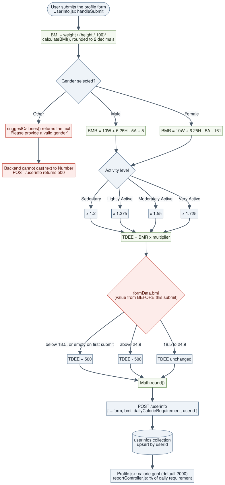
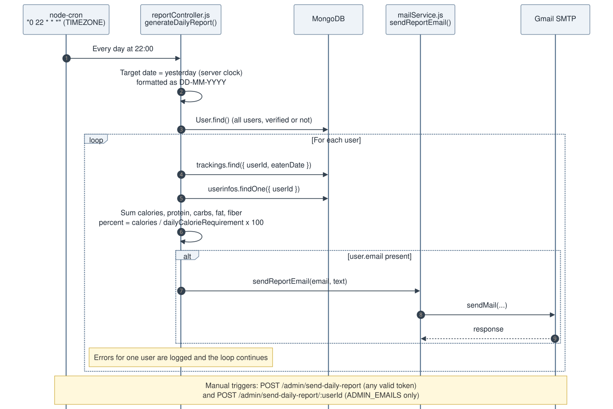
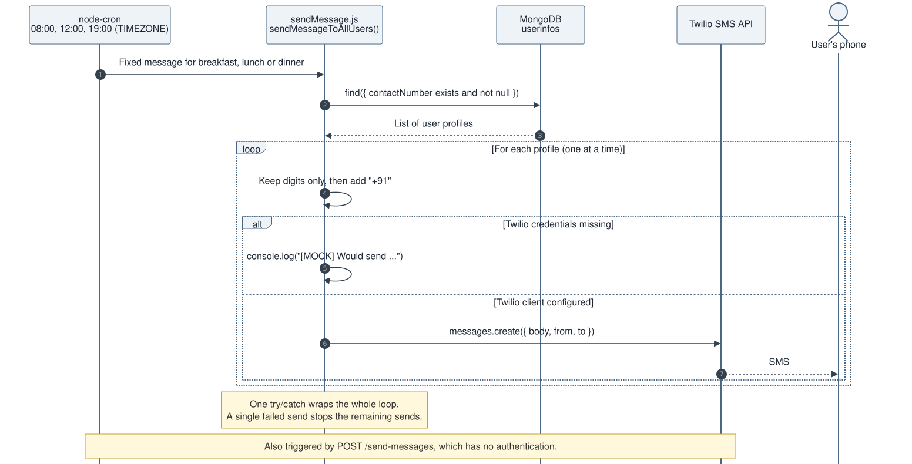
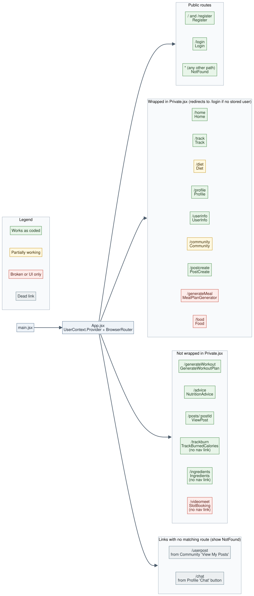
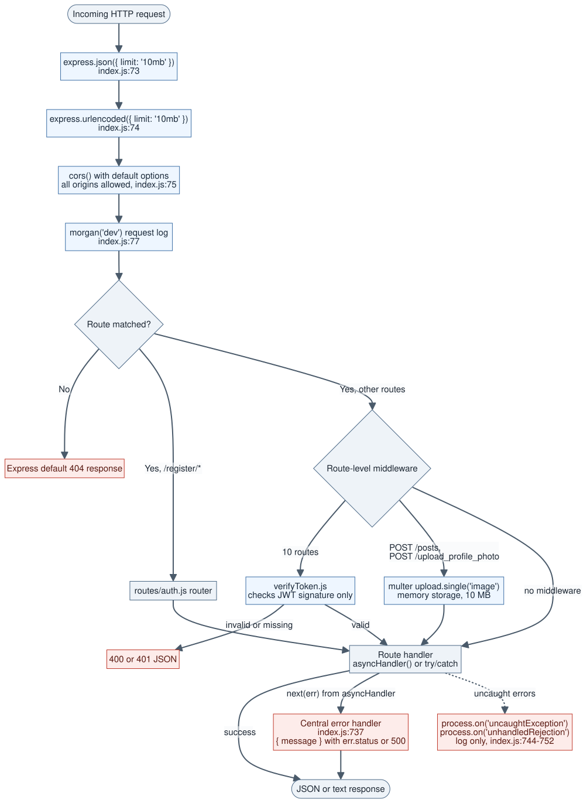

# Diagrams

All diagrams are drawn from the verified source code at commit `aa8f5a8`.

| Folder | Contents |
|---|---|
| [`mermaid/`](mermaid/) | **Editable source** (`.mmd`). Edit these, then re-export. |
| [`svg/`](svg/) | Vector exports (white background, readable in light and dark themes) |
| [`png/`](png/) | Raster exports at 2× resolution, for slides and documents |

## Diagram list

| # | Diagram | Source | SVG | PNG | Used in |
|---|---|---|---|---|---|
| 1 | System architecture and deployment | [mmd](mermaid/01-system-architecture.mmd) | [svg](svg/01-system-architecture.svg) | [png](png/01-system-architecture.png) | [03](../03-system-architecture.md), [11](../11-deployment-guide.md), [README](../../README.md) |
| 2 | Database ER diagram | [mmd](mermaid/02-database-er-diagram.mmd) | [svg](svg/02-database-er-diagram.svg) | [png](png/02-database-er-diagram.png) | [06](../06-database-design.md) |
| 3 | OTP registration sequence | [mmd](mermaid/03-otp-registration-sequence.mmd) | [svg](svg/03-otp-registration-sequence.svg) | [png](png/03-otp-registration-sequence.png) | [08](../08-authentication-and-otp-flow.md) |
| 4 | Login and JWT authentication sequence | [mmd](mermaid/04-login-jwt-sequence.mmd) | [svg](svg/04-login-jwt-sequence.svg) | [png](png/04-login-jwt-sequence.png) | [08](../08-authentication-and-otp-flow.md) |
| 5 | Food search and meal tracking sequence | [mmd](mermaid/05-food-tracking-sequence.mmd) | [svg](svg/05-food-tracking-sequence.svg) | [png](png/05-food-tracking-sequence.png) | [03](../03-system-architecture.md) |
| 6 | BMI and calorie calculation flowchart | [mmd](mermaid/06-bmi-calorie-flowchart.mmd) | [svg](svg/06-bmi-calorie-flowchart.svg) | [png](png/06-bmi-calorie-flowchart.png) | [02](../02-features-and-status.md) |
| 7 | Daily email report sequence | [mmd](mermaid/07-daily-report-sequence.mmd) | [svg](svg/07-daily-report-sequence.svg) | [png](png/07-daily-report-sequence.png) | [05](../05-backend-architecture.md) |
| 8 | SMS reminder sequence | [mmd](mermaid/08-sms-reminder-sequence.mmd) | [svg](svg/08-sms-reminder-sequence.svg) | [png](png/08-sms-reminder-sequence.png) | [05](../05-backend-architecture.md) |
| 9 | Frontend routes and component architecture | [mmd](mermaid/09-frontend-routes.mmd) | [svg](svg/09-frontend-routes.svg) | [png](png/09-frontend-routes.png) | [04](../04-frontend-architecture.md) |
| 10 | Backend middleware pipeline | [mmd](mermaid/10-backend-middleware-pipeline.mmd) | [svg](svg/10-backend-middleware-pipeline.svg) | [png](png/10-backend-middleware-pipeline.png) | [05](../05-backend-architecture.md) |

## Previews

### System architecture


### Database ER diagram


### OTP registration


### Login and JWT


### Food search and meal tracking


### BMI and calorie calculation


### Daily email report


### SMS reminders


### Frontend routes


### Backend middleware pipeline


## Colour conventions

| Colour | Meaning |
|---|---|
| Green | Works as coded / application services |
| Amber | Partially working / external services |
| Red | Broken, UI only, or an error path |
| Grey | Dead link (no matching route) |
| Blue | Data stores and middleware |

## How to edit and re-export

1. Edit the `.mmd` file. You can preview it at <https://mermaid.live> or in any editor with a Mermaid extension. GitHub also renders Mermaid inside Markdown code blocks.
2. Export to SVG and PNG with any Mermaid renderer, for example the official CLI:
   ```bash
   npx -p @mermaid-js/mermaid-cli mmdc -i mermaid/01-system-architecture.mmd -o svg/01-system-architecture.svg -b white
   npx -p @mermaid-js/mermaid-cli mmdc -i mermaid/01-system-architecture.mmd -o png/01-system-architecture.png -b white -s 2
   ```
   The current exports were produced with Mermaid 10.9.1 (theme `base`, SVG text labels instead of HTML labels, so they open in vector editors such as Inkscape) and rendered to PNG with headless Chrome at 2× scale.
3. Keep the file names the same so the links in the documentation keep working.
